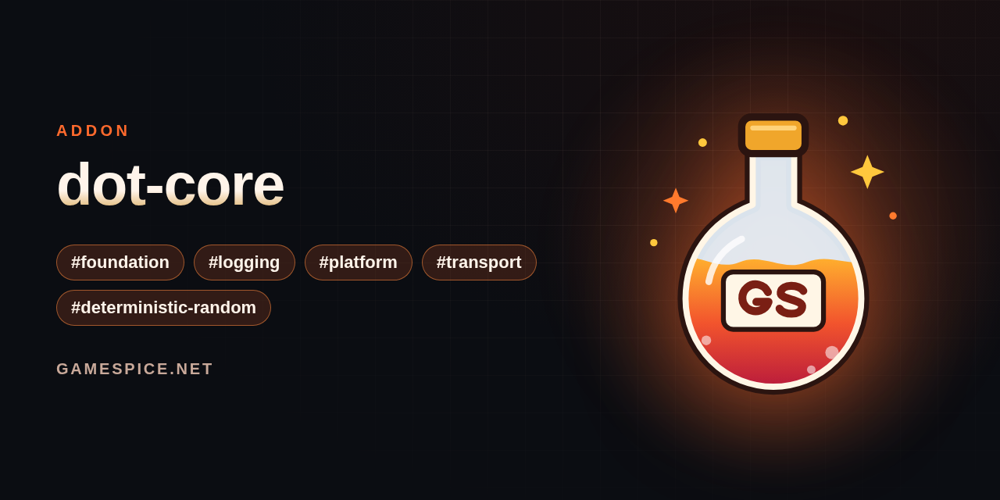

[](https://moddingcommunity.com/a/207-dot-core)

The shared foundation of the [dot-*](https://github.com/gamespice-platform) family for Godot 4.7+. It holds the small pieces every other addon needs: results and errors, logging, configuration, platform checks, paths, hashing, an HTTP client, a transport layer, reproducible randomness and a loading gate. It is the layer under [dot-server](https://github.com/gamespice-platform/server), [dot-auth](https://github.com/gamespice-platform/auth) and [dot-cloud](https://github.com/gamespice-platform/cloud).

It targets desktop (Windows, macOS, Linux), mobile (Android, iOS) and the web from one codebase. Browser limits are handled in the code, not hidden.

## Install

1. Copy `addons/dot_core/` into your project.
2. Enable dot-core in *Project > Project Settings > Plugins*.
3. Run `godot --headless --path . --import` once so the `Dot*` classes register.

The plugin only registers inspector types. Every class is available by its `class_name` whether the plugin is enabled or not. Starting a new game? Begin from [dot-game-template](https://github.com/gamespice-platform/game-template).

## First steps

1. Return failures as a `DotResult` and branch on its `DotError.CODE_*`, never on the message.
2. Log through `DotLog`, with a `CHANNEL` constant per file.
3. Run the example scene under [Test](#test) on every platform you ship to.

## What is in it

| Class | What it does |
| --- | --- |
| `DotResult`, `DotError` | The return type of everything that can fail. `CODE_*` values are stable. Reading `.value` on a failure raises an error instead of returning a default. |
| `DotPlatform` | Cached checks for threads, UDP, listening, pack mounting and storage. Ask about capabilities, not platform names. |
| `DotNodeRef` | An inspector-editable description of which node: relative, absolute, group, registry, ancestor or descendant by type, or create if missing. Replaces hardcoded scene paths. |
| `DotConfig` | Layered configuration with key discovery and protection for secret keys. |
| `DotScheduler`, `DotJob` | Long work in slices. Worker threads where they exist, a per-frame time budget where they do not. |
| `DotTransport` | Swappable multiplayer transport. WebSocket serves browser and native clients from one listener. ENet is lighter but does not work in browsers. `DotTransportAuto` picks one and logs why. |
| `DotHttp` | An `HTTPRequest` client with retries, jittered backoff, `Retry-After`, resumable downloads and connection pooling. Works in the browser. |
| `DotLog`, `DotLogSink` | Levelled, channelled logging with structured fields, rotating files and UDP forwarding. [dot-log](https://github.com/gamespice-platform/log) adds more sinks. |
| `DotPaths` | Path cleaning that refuses traversal instead of repairing it, atomic writes and web filesystem flushing. |
| `DotHash` | SHA-256, HMAC, constant-time comparison, base64url and secure random tokens. |
| `DotRandomStream` and related | Randomness another machine can reproduce. A draw depends only on a key and an index, so peers that draw in a different order still agree. `DotRandomTable` does weighted picks, `DotRandomSchedule` does events in ticks, and `DotRandomManager` hands out named streams. See [docs/randomness.md](docs/randomness.md). |
| `DotLoadGate`, `DotLoadingCover` | Holds the screen until the game is ready to be seen. See [docs/loading.md](docs/loading.md). |

`DotLog` mirrors only ERROR and above into Godot's own output (`mirror_min_level`). A debug build adds a backtrace to every mirrored line, and a recoverable warning would then look like a crash.

## Configuration layers

Every addon reads settings in the same order, weakest first:

| Layer | Where |
| --- | --- |
| Addon defaults | The addon's schema, then `cfg/addon/<addon>/` |
| Game | `cfg/game/<game>/<addon>/` |
| Server operator | `cfg/server/addon/<addon>/`, then `cfg/server/game/<game>/<addon>/` |
| Environment | `DOT_*` variables |
| Command line | `--flag` arguments |
| Runtime | For example a console `set` |

The folder name is the addon name with `-` written as `_`. Secrets are read from files only. A key marked sensitive is refused from the environment and the command line. Add `cfg/*` to your export preset's `include_filter`, or the files are missing from exported builds. See [docs/addon-config.md](docs/addon-config.md).

## Design notes

| Rule | Why |
| --- | --- |
| No autoloads. | An autoload reserves a global name, fixes the start order and cannot be created twice. Use `DotRegistry` for lookup and place nodes yourself. |
| No hardcoded scene paths. | Anything that needs a host node exports a `DotNodeRef`. |
| Browser limits are real. | There is no UDP, no `HTTPClient`, no threads by default, the filesystem needs explicit flushes, and a resource pack cannot be unmounted. See [docs/transports.md](docs/transports.md#where-each-constraint-lives). |

More notes are in the [docs index](docs/README.md).

## Test

```bash
godot --headless --path . --import
godot --headless --path . res://examples/capability_report.tscn
godot --headless --path . res://examples/randomness_selftest.tscn
```

Worker caps are settings: `DotParallel.auto_max` (default 8, 0 = unlimited) and `DotScheduler.auto_thread_max` (default 4, 0 = unlimited); negatives are refused with an error.

The first scene prints what the build can do. The second checks the randomness code. Both run offline. The capability report shows quickly that a web export has no threads or that a device reports no storage quota, which changes how dot-cloud behaves. The `examples/` folder holds more self-tests.

## Status

Built and maintained with Claude Code. The test suites pass, but little of this has been in front of real players yet. Please report rough edges by opening an issue.

## Licence

MIT. See [LICENSE](LICENSE). Only the TMC back-end web infrastructure is not open source.
